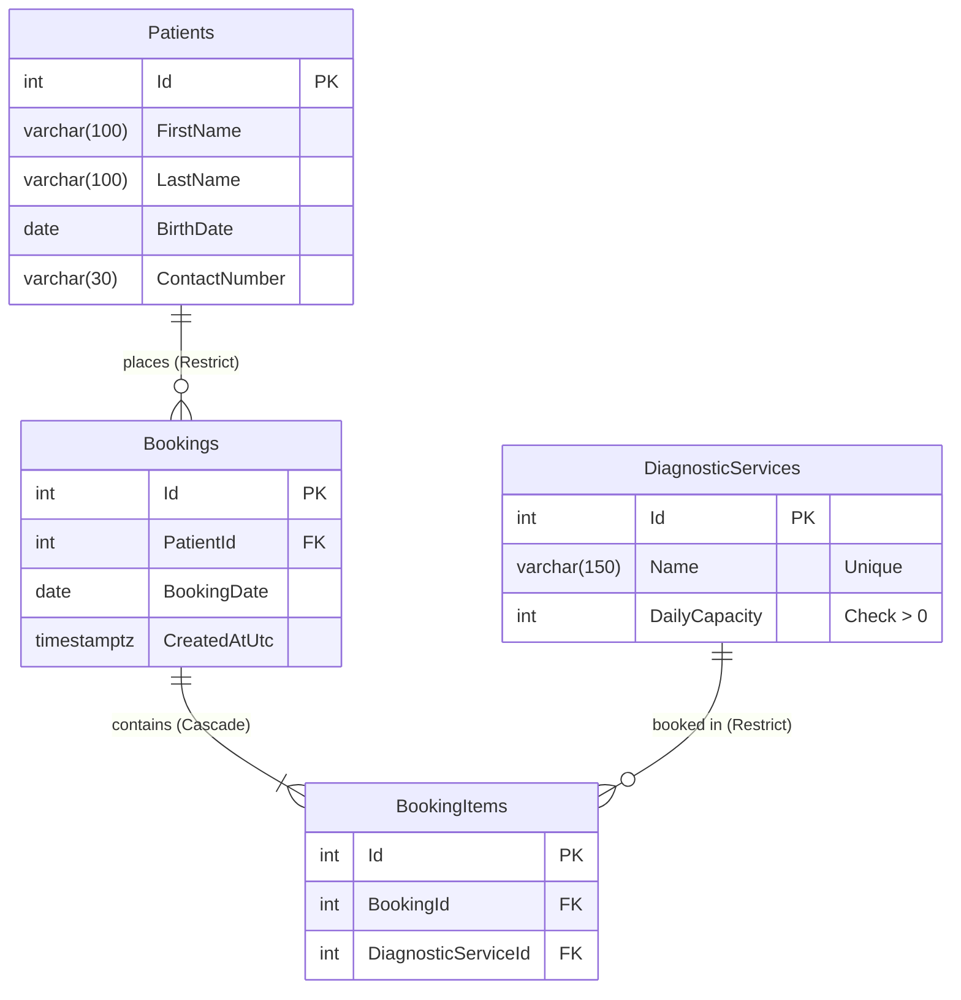

# Mancawan-Solon-Careflow
Mancawan and Solon's Careflow App

# CareFlow — Diagnostic Booking Management System

CareFlow is a desktop application built with **.NET 8**, **Avalonia UI**, **CommunityToolkit.Mvvm**, and **Entity Framework Core (PostgreSQL / Npgsql)** for managing patient diagnostic service bookings, enforcing daily service capacity limits, and persisting booking records reliably.

---

## Tech Stack
* **Framework:** .NET 8 (C#)
* **Desktop UI:** Avalonia UI (MVVM pattern with `CommunityToolkit.Mvvm`)
* **Database & ORM:** PostgreSQL with Entity Framework Core (`Npgsql.EntityFrameworkCore.PostgreSQL`)
* **Testing:** xUnit (`CareFlow.Tests`)

---

## Setup & Running Instructions

### 1. Prerequisites
* [.NET 8 SDK](https://dotnet.microsoft.com/download/dotnet/8.0)
* [PostgreSQL](https://www.postgresql.org/download/) (with pgAdmin 4 or `psql`)
* EF Core CLI tool matching .NET 8:
  ```powershell
  dotnet tool install --global dotnet-ef --version 8.0.11
  ```

### 2. Configure Database Connection
1. Create a PostgreSQL database named `careflow`.
2. Open `CareFlow/appsettings.json` and update the connection string with your local PostgreSQL settings:
   ```json
   {
     "ConnectionStrings": {
       "CareFlowConnection": "Host=localhost;Port=5432;Database=careflow;Username=postgres;Password=YOUR_LOCAL_PASSWORD"
     }
   }
   ```
   *(Do not commit real database passwords to the repository.)*

### 3. Apply EF Core Migrations
From the repository root, apply the database schema migration:
```powershell
dotnet ef database update --project CareFlow\CareFlow.csproj --startup-project CareFlow\CareFlow.csproj
```

### 4. Seed Fictional Sample Data
Run the following SQL script in pgAdmin 4 (Query Tool on `careflow`) to populate fictional patients and diagnostic services:
```sql
INSERT INTO "Patients" ("FirstName", "LastName", "BirthDate", "ContactNumber")
VALUES
    ('Elena', 'Reyes', '1998-04-12', '09171234567'),
    ('Marco', 'Santos', '1992-09-25', '09182345678'),
    ('Clarissa', 'Mendoza', '2001-01-18', '09193456789');

INSERT INTO "DiagnosticServices" ("Name", "DailyCapacity")
VALUES
    ('Complete Blood Count', 5),
    ('Urinalysis', 5),
    ('Chest X-Ray', 3),
    ('ECG', 4);
```

### 5. Run the Application & Unit Tests
* **Run Desktop App:**
  ```powershell
  dotnet run --project CareFlow\CareFlow.csproj
  ```
* **Run Unit Tests:**
  ```powershell
  dotnet test
  ```

---

## Relational Database Design (ERD)



### Schema Constraints & Integrity Rules
* **`Patients` -> `Bookings`:** One-to-many (`DeleteBehavior.Restrict`).
* **`Bookings` -> `BookingItems`:** One-to-many (`DeleteBehavior.Cascade` when a booking is cancelled/deleted).
* **`DiagnosticServices` -> `BookingItems`:** One-to-many (`DeleteBehavior.Restrict`); `Name` is unique and `DailyCapacity > 0`.
* **`BookingItems` Composite Unique Index:** `(BookingId, DiagnosticServiceId)` prevents duplicate services inside the same booking.

---

## Acceptance Criteria Verification Checklist

| ID | Criterion | Verification Method | Status |
| :--- | :--- | :--- | :--- |
| **AC-01** | View daily availability and remaining capacity per diagnostic service | Selected dates in the Avalonia UI and verified remaining/booked counts match PostgreSQL records. | **Pass** |
| **AC-02** | Create a valid booking with 1–3 diagnostic services for an existing patient | Selected a patient and 1–3 services, confirmed booking, and verified updated capacity counts and Confirmed Bookings list. | **Pass** |
| **AC-03** | Reject invalid booking requests (0 services, >3 services, past dates, unknown patient) | Tested submitting 0 services, 4 services, and past dates; confirmed rejection messages appeared with no partial rows saved. | **Pass** |
| **AC-04** | Prevent overbooking when a service reaches daily capacity | Booked a service up to its daily limit (`0 remaining`) and verified subsequent booking attempts on that date were rejected. | **Pass** |
| **AC-05** | Maintain atomic transaction consistency on failed or cancelled bookings | Verified failed bookings roll back cleanly and cancelling a booking removes its items and restores available capacity. | **Pass** |
| **AC-06** | Persist confirmed bookings and availability across application restarts | Closed and relaunched CareFlow and verified confirmed bookings and remaining capacities matched PostgreSQL tables. | **Pass** |

---

## AI Assistance Acknowledgment
AI tools were used during development to assist with debugging EF Core/Avalonia setup issues, refining ViewModel/XAML bindings, and drafting project documentation. All code, database migrations, business rules, and verification tests were reviewed, executed, and validated by the project authors.
